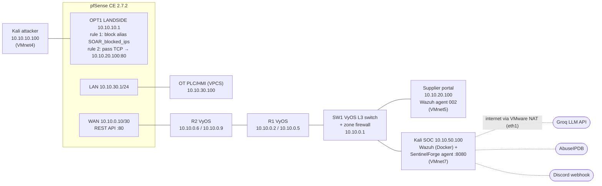

# SentinelForge: an AI SOC Agent for a Smart-Factory Network

SentinelForge is an **autonomous AI SOC analyst** that defends a small manufacturing (IT/OT) lab network.
When Wazuh detects an attack, a Python agent investigates it with tools and decides on a verdict. Then it **blocks the attacker at the pfSense perimeter firewall** and on the target host, writes an incident report, and sends a notification to the on-call channel. A typical case takes about 20–30 seconds, with no human in the loop.

> One lightweight Python service replaces a classic SOAR + case-management stack (Shuffle, TheHive, Cortex).

## Demo

▶️ **[Watch the demo video](docs/demo.mp4)** (MP4, ~93 MB — opens in GitHub's video player)

An attacker on the landside network hits the supplier portal with SQL injection. Wazuh detects it, the AI agent
investigates, decides it is malicious, and blocks the attacker at the pfSense firewall, with no human in the loop.
See [§9.7 Running the live demo](#97-running-the-live-demo) to reproduce it.

---

## Table of contents

1. [Overview](#1-overview)
2. [Architecture](#2-architecture)
3. [Prerequisites](#3-prerequisites)
4. [Network build](#4-network-build)
5. [Lab hosts: supplier portal and attacker](#5-lab-hosts-supplier-portal-and-attacker)
6. [SOC stack: Wazuh](#6-soc-stack-wazuh)
7. [The AI agent](#7-the-ai-agent)
8. [Integration: Wazuh → agent → block](#8-integration-wazuh--agent--block)
9. [Attack simulation and validation](#9-attack-simulation-and-validation)
10. [Daily operation (every lab boot)](#10-daily-operation-every-lab-boot)
11. [Troubleshooting](#11-troubleshooting)
12. [Repository layout](#12-repository-layout)
13. [Future work](#13-future-work)
14. [Credits and license](#14-credits-and-license)

> 🎬 **Running the demo?** Start with [§9.7 Running the live demo](#97-running-the-live-demo) and the step-by-step checklist in [`DEMO-STEPS.md`](DEMO-STEPS.md).

> 🔐 **Secrets.** Every password, API key, token and webhook URL in this guide is a placeholder such as `<GROQ_API_KEY>`.
> Put real values only in a `.env` file (`chmod 600`). **Never commit `.env`**; it is listed in `.gitignore`.
> The lab uses default product passwords (pfSense, Wazuh). Change them if the lab is reachable from any network you don't control.

---

## 1. Overview

### What it is
SentinelForge connects four pieces:

| Piece | Job |
|---|---|
| **Wazuh 4.9.2** (SIEM) | Detects attacks on the factory's internet-facing supplier portal. |
| **SentinelForge agent** (Python, FastAPI) | Receives each high-severity alert and runs an **LLM tool-calling loop** (Groq `openai/gpt-oss-120b`) to investigate, judge, contain and document it. |
| **pfSense CE 2.7.2** (perimeter firewall) | Enforces the block: the agent adds the attacker IP to an alias that a firewall rule drops. |
| **Wazuh active-response** | A second, host-level block (`iptables DROP`) on the attacked server. |

### The problem it solves
A Tier-1 SOC analyst spends most of the day on the same loop: read the alert, check IP reputation, look for related alerts, check how critical the target is, decide, block, write the ticket. SentinelForge automates that loop. It still keeps a human-readable record of every step and keeps **hard safety limits in code** that the AI cannot override.

### Why manufacturing
Manufacturing has been the **most-attacked industry** for several years running (ransomware especially). Factories mix IT and OT networks, have little downtime tolerance, and often run small security teams. That makes them a strong use case for autonomous Tier-1 triage. The lab follows the **Purdue model** so the IT/OT boundary is explicit.

### What the agent does on one alert
1. **Investigate.** It calls tools: IP reputation (AbuseIPDB), recent Wazuh alerts from the same source, and asset context (zone and criticality of the target).
2. **Decide.** It produces a verdict (`malicious` / `suspicious` / `benign` / `false_positive`), a confidence score and a severity.
3. **Contain.** If it judges the source malicious with confidence ≥ 0.85, it calls `block_ip`. **Code guardrails** then decide whether the block is allowed.
4. **Document.** It writes a Markdown incident report with MITRE ATT&CK mapping, IOCs, the actions taken (verified by code), and a recommendation.
5. **Notify.** It posts a card to a Discord channel and shows the case on a web dashboard.

---

## 2. Architecture

### 2.1 Purdue zones and subnets

| Purdue level | Zone | Subnet | Gateway | Host(s) used by the pipeline |
|---|---|---|---|---|
| L5 / untrusted | **Landside (enterprise / external side)** | `10.10.10.0/24` | `10.10.10.1` (pfSense OPT1) | Kali **attacker** `10.10.10.100` |
| L3.5 | **Industrial DMZ** | `10.10.20.0/24` | `10.10.20.1` (SW1) | **Supplier portal** `10.10.20.100` (vulnerable web app, Wazuh agent `002`) |
| L2 / L1 | **OT control** | `10.10.30.0/24` | `10.10.30.1` (pfSense LAN) | Simulated PLC/HMI `10.10.30.100` (VPCS) |
| L4 | IT core (reserved) | `10.10.40.0/24` | `10.10.40.1` (SW1) | none (protected range in the guardrails) |
| Security | **SOC** | `10.10.50.0/24` | `10.10.50.1` (SW1) | Kali SOC `10.10.50.100`: Wazuh + SentinelForge agent |
| Infrastructure | Point-to-point links | `10.10.0.0/30`, `10.10.0.4/30`, `10.10.0.8/30` | n/a | SW1, R1, R2, pfSense WAN `10.10.0.10` |

### 2.2 Topology
The network runs in **GNS3** (VyOS routers + pfSense). The servers are **VMware Workstation** VMs, bridged into GNS3 through host-only VMnets.

- **SW1** (VyOS) is the L3 core switch and zone firewall. It is the gateway for the DMZ and the SOC.
- **R1 and R2** (VyOS) are OSPF area 0 routers between SW1 and pfSense.
- **pfSense** is the perimeter firewall. Its **OPT1 "LANDSIDE"** interface (`10.10.10.1`) is the only way into the network from the attacker segment.
- The **attacker** sits behind pfSense OPT1. Its traffic to the portal goes **through pfSense with no NAT**, so Wazuh sees the attacker's real IP (`10.10.10.100`), and a pfSense alias block really stops it.



### 2.3 Data flow of one attack

```
Kali attacker 10.10.10.100
   │  SQL injection (HTTP GET) ── through pfSense OPT1 (rule 2, no NAT) ── R2 ── R1 ── SW1 (rule 300)
   ▼
Supplier portal 10.10.20.100  (Flask log → journald → Wazuh agent 002)
   │
   ▼
Wazuh manager (SOC) ── decoder flask-werkzeug ── rule 100210 (level 12, MITRE T1190)
   │  wazuh-integratord, level ≥ 10
   ▼
custom-w2agent.py ── HTTP POST ──► SentinelForge agent  http://10.10.50.100:8080/alert
                                      │  Groq tool-calling loop (max 6 turns)
                                      │   get_ip_reputation → search_wazuh_alerts → get_asset_context
                                      │   → block_ip (guardrails in code) → write_incident_report
                                      ▼
            ┌─────────────────────────┼──────────────────────────┐
            ▼                         ▼                          ▼
  pfSense REST API             Wazuh API active-response    SQLite case + Markdown report
  alias SOAR_blocked_ips       !firewall-drop on agent 002  + dashboard + Discord card
  += 10.10.10.100, apply       → iptables DROP on portal
            │
            ▼
  Attacker's next connection is dropped on OPT1 → curl times out
```

---

## 3. Prerequisites

### 3.1 Hardware and VMs

| Machine | Platform | RAM | Network |
|---|---|---|---|
| Physical host | Windows + VMware Workstation + GNS3 | **16 GB** | n/a |
| GNS3 VM (runs SW1, R1, R2, pfSense, VPCS) | VMware VM | check yours (must fit pfSense **1536 MB** + three VyOS nodes) | adapters on VMnet4, VMnet5, VMnet7 |
| VyOS nodes SW1, R1, R2 | GNS3 (QEMU) | check yours | n/a |
| pfSense | GNS3 (QEMU) | **1536 MB** | 3 NICs |
| **Kali SOC** (Wazuh + agent) | VMware VM, 4 vCPU | **8 GB** | VMnet7 (`eth0`) + NAT (`eth1`) |
| Supplier portal | VMware VM, Ubuntu Server 22.04.5, 1 vCPU, 8 GB disk | **1500 MB** | VMnet5 |
| Kali attacker | VMware VM, Kali 2025.3 | **2 GB** | VMnet4 |

With the full stack running, the SOC uses about **3.2 GB of its 8 GB**: three Wazuh containers plus the agent (~100–200 MB).

### 3.2 Software versions (as built)

| Component | Version |
|---|---|
| pfSense | CE **2.7.2**-RELEASE |
| pfSense REST API package | `pfSense-pkg-RESTAPI` **v2.4.3** (the last release that supports CE 2.7.2) |
| VyOS | rolling build |
| Wazuh manager / indexer / dashboard / agent | **4.9.2** (`wazuh-docker` tag `v4.9.2`, single-node) |
| Docker Engine / Compose plugin | 28.5.2 / v5.4.0 |
| Portal | Ubuntu 22.04.5, Python 3.10.12, **Flask 2.0.3 + Werkzeug 2.0.3** (pinned pair), bcrypt 5.0.0 |
| Agent | Python 3.13, FastAPI 0.162.2, uvicorn 0.54.0, requests 2.34.2, python-dotenv 1.2.4 |
| LLM | Groq, model **`openai/gpt-oss-120b`** (supports function calling) |

### 3.3 Accounts and API keys

| Service | What you need | Used for | `.env` variable |
|---|---|---|---|
| [Groq](https://console.groq.com) | free API key | the agent's LLM | `GROQ_API_KEY` |
| [AbuseIPDB](https://www.abuseipdb.com) | free API key | IP reputation tool | `ABUSEIPDB_KEY` |
| Discord | a channel **webhook URL** (Channel → Integrations → Webhooks) | case notifications | `NOTIFY_WEBHOOK` |

> The SOC needs outbound internet for Groq, AbuseIPDB and Discord. The lab networks themselves stay offline (see [§4.6](#46-soc-vm-networking)).

---

## 4. Network build

### 4.1 VMware virtual networks

**Why:** each lab zone is a separate layer-2 segment. VMware host-only networks carry them into GNS3.

On the Windows host, open **Virtual Network Editor** (Run as administrator). For each lab VMnet choose **Host-only**, **uncheck** "Connect a host virtual adapter" and **uncheck** "Use local DHCP service". A host adapter would put a host IP on the segment that collides with the zone gateway.

| VMnet | Subnet | Zone |
|---|---|---|
| VMnet4 | `10.10.10.0/24` | Landside (attacker) |
| VMnet5 | `10.10.20.0/24` | DMZ (portal) |
| VMnet7 | `10.10.50.0/24` | SOC |
| VMnet8 | `192.168.13.0/24`, gateway `.2` | VMware NAT (SOC internet only) |

Add one adapter per lab VMnet to the **GNS3 VM**. Inside the GNS3 VM they appear as:

| GNS3 VM interface | VMnet | GNS3 Cloud node |
|---|---|---|
| `eth2` | VMnet7 | Cloud1-SOC |
| `eth4` | VMnet4 | Cloud3-AttackerSide |
| `eth5` | VMnet5 | Cloud4-DMZ |

Promiscuous mode on these bridges is **lost at every GNS3 VM boot**. Without it, frames for the VMs are not delivered:

```bash
# On: GNS3 VM (every boot)
sudo ip link set eth2 promisc on
sudo ip link set eth4 promisc on
sudo ip link set eth5 promisc on
```

> ✅ **Verify**
> ```bash
> # On: GNS3 VM
> for i in 2 4 5; do ip link show eth$i | head -1; done
> ```
> Expected: every line contains `PROMISC`.

### 4.2 GNS3 wiring

**Why:** VyOS names its interfaces by PCI order, not by GNS3 slot. Give SW1 **6 adapters** (type *virtio-net-pci*) so that the interface names below match. **Rule:** the last byte of each VyOS MAC = the GNS3 slot number. Check with `show interfaces` and re-wire if they differ.

| Link | GNS3 ports | VyOS / pfSense name |
|---|---|---|
| SW1 ↔ R1 | SW1 Ethernet0 ↔ R1 Ethernet0 | SW1 `eth4` ↔ R1 `eth7` |
| R1 ↔ R2 | R1 Ethernet1 ↔ R2 Ethernet0 | R1 `eth8` ↔ R2 `eth4` |
| R2 ↔ pfSense WAN | R2 Ethernet1 ↔ pfSense Ethernet0 | R2 `eth6` ↔ pfSense `vtnet0` |
| pfSense LAN ↔ OT | pfSense Ethernet1 ↔ VPCS `OT-PLC-01` | pfSense `vtnet1` |
| pfSense OPT1 ↔ attacker | pfSense Ethernet2 ↔ Cloud3-AttackerSide (`eth4`) | pfSense `vtnet2` |
| SW1 ↔ SOC | SW1 Ethernet3 ↔ Cloud1-SOC (`eth2`) | SW1 `eth8` |
| SW1 ↔ DMZ | SW1 Ethernet4 ↔ Cloud4-DMZ (`eth5`) | SW1 `eth6` |

Consoles (telnet to the GNS3 VM): SW1 `:5002`, R1 `:5004`, R2 `:5006`. pfSense is managed over its web UI and REST API.

### 4.3 VyOS: SW1 (core switch + zone firewall)

**Why:** SW1 is the gateway for the DMZ and the SOC, runs OSPF towards R1, and enforces which zone may talk to which.

**Interface addressing and OSPF.**

> ⚠️ The addresses below are the verified IP plan of the working lab. The command lines are standard VyOS syntax rebuilt from that plan, not a dump of the original config. Compare them with `show configuration commands` on your build.

```
# On: SW1 (VyOS)
configure
set interfaces ethernet eth4 address 10.10.0.1/30
set interfaces ethernet eth6 address 10.10.20.1/24
set interfaces ethernet eth8 address 10.10.50.1/24
set protocols ospf parameters router-id 1.1.1.1
set protocols ospf interface eth4 area 0
set protocols ospf interface eth6 area 0
set protocols ospf interface eth8 area 0
commit
save
exit
```

**Zone firewall.** These are the rules the pipeline needs: return traffic, SOC → anywhere, the portal agent → SOC Wazuh, and Landside → DMZ.

```
# On: SW1 (VyOS)
configure
# Rule 10: allow return traffic
set firewall ipv4 forward filter rule 10 action accept
set firewall ipv4 forward filter rule 10 state established
set firewall ipv4 forward filter rule 10 state related
set firewall ipv4 forward filter rule 10 description "Allow established/related return traffic"

# Rule 100: SOC can reach every zone (API calls to pfSense, SSH, etc.)
set firewall ipv4 forward filter rule 100 action accept
set firewall ipv4 forward filter rule 100 source address 10.10.50.0/24
set firewall ipv4 forward filter rule 100 description "SOC can reach all zones"

# Rule 170: DMZ portal Wazuh agent -> SOC manager (1514/1515)
set firewall ipv4 forward filter rule 170 action accept
set firewall ipv4 forward filter rule 170 source address 10.10.20.0/24
set firewall ipv4 forward filter rule 170 destination address 10.10.50.0/24
set firewall ipv4 forward filter rule 170 destination port 1514,1515
set firewall ipv4 forward filter rule 170 protocol tcp
set firewall ipv4 forward filter rule 170 description "DMZ portal agent to SOC Wazuh (1514/1515)"

# Rule 300: Landside -> DMZ only
set firewall ipv4 forward filter rule 300 action accept
set firewall ipv4 forward filter rule 300 source address 10.10.10.0/24
set firewall ipv4 forward filter rule 300 destination address 10.10.20.0/24
set firewall ipv4 forward filter rule 300 description "Landside can reach DMZ only"

# Everything else is dropped
set firewall ipv4 forward filter default-action drop
commit
save
exit
```

> On this VyOS build, state matching is `state established` / `state related` with **no** `enable` keyword.

> ✅ **Verify**
> ```
> # On: SW1
> show firewall ipv4 forward filter
> sudo vtysh -c 'show ip ospf neighbor'
> ```
> Expected: rules 10, 100, 170 and 300 plus default drop. Neighbor `2.2.2.2` is `Full`.

### 4.4 VyOS: R1 and R2 (OSPF + routes to pfSense)

**Why:** R1 and R2 carry traffic between SW1 and pfSense. R2 also needs **static routes to the networks behind pfSense** (Landside and OT) and redistributes them into OSPF, so the DMZ knows how to reply to the attacker.

On this VyOS rolling build, the native `set protocols ospf` translation for R1/R2 is unreliable, so OSPF is configured **directly in `vtysh`**. `write memory` does **not** survive a reboot (`/etc/frr/frr.conf` lives in RAM), so each router also gets a **boot script**.

**Interface addressing** (⚠️ rebuilt from the verified IP plan, same note as §4.3):

```
# On: R1 (VyOS)
configure
set interfaces ethernet eth7 address 10.10.0.2/30
set interfaces ethernet eth8 address 10.10.0.5/30
commit
save
exit
```

```
# On: R2 (VyOS)
configure
set interfaces ethernet eth4 address 10.10.0.6/30
set interfaces ethernet eth6 address 10.10.0.9/30
commit
save
exit
```

**R1: OSPF, applied now and on every boot:**

```
# On: R1 (VyOS)
sudo vtysh
configure terminal
router ospf
 ospf router-id 2.2.2.2
 network 10.10.0.0/30 area 0
 network 10.10.0.4/30 area 0
end
exit

echo "/usr/bin/vtysh -c 'configure terminal' -c 'router ospf' -c 'ospf router-id 2.2.2.2' -c 'network 10.10.0.0/30 area 0' -c 'network 10.10.0.4/30 area 0' -c 'end'" | sudo tee -a /config/scripts/vyos-postconfig-bootup.script
```

**R2: OSPF, the static routes behind pfSense, and redistribution, applied now and on every boot:**

```
# On: R2 (VyOS)
sudo vtysh
configure terminal
ip route 10.10.10.0/24 10.10.0.10
ip route 10.10.30.0/24 10.10.0.10
router ospf
 ospf router-id 3.3.3.3
 network 10.10.0.4/30 area 0
 network 10.10.0.8/30 area 0
 redistribute static
end
exit

echo "/usr/bin/vtysh -c 'configure terminal' -c 'ip route 10.10.10.0/24 10.10.0.10' -c 'ip route 10.10.30.0/24 10.10.0.10' -c 'router ospf' -c 'ospf router-id 3.3.3.3' -c 'network 10.10.0.4/30 area 0' -c 'network 10.10.0.8/30 area 0' -c 'redistribute static' -c 'end'" | sudo tee -a /config/scripts/vyos-postconfig-bootup.script
```

> ✅ **Verify**
> ```
> # On: R2
> sudo vtysh -c 'show ip route static'
> # On: R1
> sudo vtysh -c 'show ip ospf neighbor'
> sudo vtysh -c 'show ip route 10.10.10.0/24'
> # On: SW1
> sudo vtysh -c 'show ip route 10.10.10.0/24'
> ```
> Expected:
> - R2: `S>* 10.10.10.0/24 … via 10.10.0.10, eth6` and `S>* 10.10.30.0/24 … via 10.10.0.10, eth6`.
> - R1: neighbors `1.1.1.1` and `3.3.3.3` are `Full`, and `10.10.10.0/24` is learned via OSPF through `10.10.0.6` on `eth8`.
> - SW1: `10.10.10.0/24` is learned via OSPF through `10.10.0.2` on `eth4`.

### 4.5 pfSense: perimeter firewall, REST API, OPT1 "LANDSIDE"

#### 4.5.1 Base install and interfaces
Install pfSense CE 2.7.2 as a GNS3 appliance with **1536 MB RAM** and three NICs. On the console, assign and address the interfaces:

| pfSense interface | NIC | Address | Notes |
|---|---|---|---|
| WAN | `vtnet0` | `10.10.0.10/30` | gateway **`10.10.0.9`** (R2) |
| LAN | `vtnet1` | `10.10.30.1/24` | OT control network |
| OPT1 "LANDSIDE" | `vtnet2` | `10.10.10.1/24` | created in [§4.5.4](#454-opt1-landside-the-attacker-segment) |

In the web UI, add a **static route** for all internal networks through R2: **System → Routing → Static Routes → Add**: network `10.10.0.0/16`, gateway the WAN gateway (`10.10.0.9`).

#### 4.5.2 Let the internal "WAN" side reach pfSense
**Why:** pfSense's WAN faces the lab's private `10.10.0.0/16` core, so the default "block private / bogon networks" settings and the default-deny WAN policy would cut off the SOC (and with it the REST API).

On the pfSense console, temporarily disable the packet filter (option **8**, shell): `pfctl -d`. Then SSH in from the SOC (`ssh admin@10.10.0.10`, option **8**) and run:

```sh
# On: pfSense shell
sed -i '' 's/<blockpriv\/>//' /cf/conf/config.xml
sed -i '' 's/<blockbogons\/>//' /cf/conf/config.xml
pfSsh.php playback enableallowallwan
/etc/rc.filter_configure
# wait 30-60 s for the filter reload to finish, then:
pfctl -e
```

The change is saved in `/cf/conf/config.xml`, so it survives reboots.

> ✅ **Verify**
> ```bash
> # On: SOC VM
> ping -c 2 10.10.0.10
> ```
> Expected: 2/2 replies.

#### 4.5.3 REST API package (v2.4.3)
**Why:** the agent controls pfSense through its REST API. Use **v2.4.3**, because it is the last release that supports CE 2.7.2 (v2.5.0+ dropped 2.7.2). pfSense can't reach GitHub from inside the lab, so download the package on the SOC and copy it over.

```bash
# On: SOC VM (internet up, see §4.6)
wget -O /tmp/pfSense-RESTAPI.pkg \
  "https://github.com/pfrest/pfSense-pkg-RESTAPI/releases/download/v2.4.3/pfSense-2.7.2-pkg-RESTAPI.pkg"
file /tmp/pfSense-RESTAPI.pkg          # expected: Zstandard compressed data
scp /tmp/pfSense-RESTAPI.pkg admin@10.10.0.10:/tmp/
ssh admin@10.10.0.10 "pkg-static add /tmp/pfSense-RESTAPI.pkg"
```

The install ends with `Initiating webConfigurator restart... done.` **After the install, the API (and web UI) answer on HTTP port 80; HTTPS 443 goes down.**

> ✅ **Verify**
> ```bash
> # On: SOC VM
> curl -s -u admin:<PFSENSE_PASSWORD> http://10.10.0.10/api/v2/system/version
> ```
> Expected: `{"code":200, … "data":{"version":"2.7.2-RELEASE", …}}`

#### 4.5.4 OPT1 "LANDSIDE": the attacker segment
**Why:** placing the attacker behind pfSense means every packet it sends to the DMZ crosses the firewall, where an alias-based block rule can drop it. **No NAT** keeps the attacker's real source IP, so Wazuh logs `10.10.10.100` (not pfSense's address) and the agent blocks the right IP.

First create the (empty) block-list alias that the agent will manage:

```bash
# On: SOC VM
PF="http://10.10.0.10/api/v2"; AUTH="admin:<PFSENSE_PASSWORD>"
curl -s -u $AUTH -X POST $PF/firewall/alias -H "Content-Type: application/json" \
  -d '{"name":"SOAR_blocked_ips","type":"host","descr":"IPs blocked by SentinelForge","address":[],"detail":[]}'
```

Then create the interface, its three rules and the no-NAT mapping. **Run the POSTs at least 1 second apart.** Rules created in the same second get the same tracker ID.

```bash
# On: SOC VM
H="Content-Type: application/json"

# 1. OPT1 interface (leave "gateway" out entirely: an empty "gateway":"" is rejected)
curl -s -u $AUTH -X POST $PF/interface -H "$H" \
  -d '{"if":"vtnet2","enable":true,"descr":"LANDSIDE","typev4":"static","ipaddr":"10.10.10.1","subnet":24,"blockpriv":false,"blockbogons":false,"typev6":"none"}'
curl -s -u $AUTH -X POST $PF/interface/apply ; sleep 2

# 2. OPT1 rules, in this order
curl -s -u $AUTH -X POST $PF/firewall/rule -H "$H" \
  -d '{"type":"block","interface":["opt1"],"ipprotocol":"inet","source":"SOAR_blocked_ips","destination":"any","log":true,"descr":"SOAR blocklist"}' ; sleep 1
curl -s -u $AUTH -X POST $PF/firewall/rule -H "$H" \
  -d '{"type":"pass","interface":["opt1"],"ipprotocol":"inet","protocol":"tcp","source":"10.10.10.0/24","destination":"10.10.20.100","destination_port":"80","descr":"Landside to DMZ portal"}' ; sleep 1
curl -s -u $AUTH -X POST $PF/firewall/rule -H "$H" \
  -d '{"type":"pass","interface":["opt1"],"ipprotocol":"inet","protocol":"icmp","icmptype":["echoreq"],"source":"10.10.10.0/24","destination":"(self)","descr":"Landside ping fw"}' ; sleep 1
curl -s -u $AUTH -X POST $PF/firewall/apply -H "$H" -d '{"async":false}'

# 3. Outbound NAT: Hybrid + "do not NAT" Landside -> internal networks
curl -s -u $AUTH -X PATCH $PF/firewall/nat/outbound/mode -H "$H" -d '{"mode":"hybrid"}'
curl -s -u $AUTH -X POST $PF/firewall/nat/outbound/mapping -H "$H" \
  -d '{"interface":"wan","source":"10.10.10.0/24","destination":"10.10.0.0/16","nonat":true,"descr":"No NAT Landside to internal"}'
curl -s -u $AUTH -X POST $PF/firewall/apply -H "$H" -d '{"async":false}'
```

<details>
<summary>Web UI equivalent (same result)</summary>

| Where | Setting |
|---|---|
| Interfaces → Assignments | add `vtnet2` → **OPT1**, description `LANDSIDE` |
| Interfaces → OPT1 | Enable; Static IPv4 `10.10.10.1/24`; Upstream gateway **None**; Block private **off**; Block bogon **off** |
| Firewall → Aliases | Host alias `SOAR_blocked_ips`, empty |
| Firewall → Rules → OPT1, rule 1 | **Block**, IPv4, any protocol, source alias `SOAR_blocked_ips` → any, **Log** ✔, `SOAR blocklist` |
| Firewall → Rules → OPT1, rule 2 | **Pass**, IPv4 TCP, `10.10.10.0/24` → `10.10.20.100` port 80, `Landside to DMZ portal` |
| Firewall → Rules → OPT1, rule 3 | **Pass**, IPv4 ICMP echo-request, `10.10.10.0/24` → This Firewall, `Landside ping fw` |
| Firewall → NAT → Outbound | Mode **Hybrid**; top mapping: **Do not NAT**, interface WAN, source `10.10.10.0/24`, destination `10.10.0.0/16`, `No NAT Landside to internal` |
</details>

> ✅ **Verify**
> ```bash
> # On: SOC VM
> curl -s -u $AUTH $PF/firewall/aliases            # SOAR_blocked_ips, "address": []
> curl -s -u $AUTH $PF/firewall/apply              # "applied": true (apply runs in the background; re-check if false)
> ```
> ```
> # On: pfSense (Diagnostics → Command Prompt)
> pfctl -s nat | grep 10.10.10
> pfctl -sr | grep -i opt1
> ```
> Expected: `no nat on vtnet0 inet from 10.10.10.0/24 to 10.10.0.0/16` appears **before** the automatic NAT rule, and the OPT1 rules show the block on `<SOAR_blocked_ips>` first.

**Alias API patterns used by the agent** (for reference):

| Action | Call |
|---|---|
| Read aliases | `GET /api/v2/firewall/aliases` |
| Set alias contents | `PATCH /api/v2/firewall/alias` with `{"id":<id>,"address":[...],"detail":[...]}` (PATCH, not PUT) |
| **Activate** | `POST /api/v2/firewall/apply` with `{"async":false}`. **A changed alias does nothing until applied.** |

### 4.6 SOC VM networking

**Why:** the SOC sits on the lab (`eth0`) but also needs the internet (`eth1`, VMware NAT) to reach Groq, AbuseIPDB and Discord. The lab must keep using `eth0`.

`/etc/network/interfaces` (static lab address):

```
# On: SOC VM
auto lo
iface lo inet loopback

auto eth0
iface eth0 inet static
    address 10.10.50.100
    netmask 255.255.255.0
    gateway 10.10.50.1
```

Keep NetworkManager away from both NICs, in `/etc/NetworkManager/conf.d/99-sentinelforge.conf`:

```ini
[keyfile]
unmanaged-devices=interface-name:eth0;interface-name:eth1
```

**Internet on (every boot).** Get a DHCP lease on `eth1`, then remove the lab default route so internet traffic leaves via NAT. Keep an explicit `10.10.0.0/16` route so the lab stays reachable. Pin DNS to public resolvers, because VMware's NAT DNS is unreliable. Kali no longer ships `dhclient`, so use `dhcpcd`.

```bash
# On: SOC VM (bringup.sh does this for you, see §10)
sudo ip link set eth1 up
sudo dhcpcd eth1
sudo ip route del default via 10.10.50.1 dev eth0 2>/dev/null
sudo ip route replace 10.10.0.0/16 via 10.10.50.1 dev eth0
printf 'nameserver 1.1.1.1\nnameserver 8.8.8.8\n' | sudo tee /etc/resolv.conf
```

> ✅ **Verify**
> ```bash
> # On: SOC VM
> ip route | grep -E 'default|10.10.0.0'
> curl -s -o /dev/null -w "%{http_code}\n" -A curl/8.0 https://api.groq.com
> ping -c 2 10.10.0.10
> ```
> Expected: a single `default via 192.168.13.2 dev eth1`, `10.10.0.0/16 via 10.10.50.1 dev eth0`, an HTTP code from Groq (not `000`), and pfSense answering.

---

## 5. Lab hosts: supplier portal and attacker

### 5.1 Supplier portal (DMZ, `10.10.20.100`)

**Why:** this is the factory's internet-facing service and the attack target. It is a small **deliberately vulnerable Flask app** with an SQL injection in its search endpoint (CWE-89), a weak admin login (CWE-521/307) and an unrestricted upload (CWE-434). It keeps the same routes as the tested build (`/flights/search?origin=…`), and the detection rules key off those routes.

**VM:** Ubuntu Server 22.04.5, 1 vCPU, 1500 MB RAM, 8 GB disk, **one NIC on VMnet5**. In the installer, set the network manually: `ens33` = `10.10.20.100/24`, gateway `10.10.20.1`. Install OpenSSH server. Create an admin user (`<PORTAL_SSH_USER>`).

Stop cloud-init from rewriting the network config:

```bash
# On: portal VM
echo 'network: {config: disabled}' | sudo tee /etc/cloud/cloud.cfg.d/99-disable-network-config.cfg
```

**Packages.** The DMZ has no internet. Temporarily add a **second VMware NAT adapter**, install the packages, then remove the adapter again:

```bash
# On: portal VM (temporary NAT adapter = ens37)
sudo dhclient ens37
sudo ip route del default via 10.10.20.1 dev ens33
sudo ip route add default via 192.168.13.2 dev ens37
sudo resolvectl dns ens37 8.8.8.8 1.1.1.1
sudo apt update && sudo apt install -y python3-pip python3-venv sqlite3

sudo mkdir -p /opt/sf-portal && sudo chown $USER:$USER /opt/sf-portal
cd /opt/sf-portal && python3 -m venv venv
./venv/bin/pip install flask==2.0.3 werkzeug==2.0.3 bcrypt
./venv/bin/python3 -c "import flask, werkzeug; print(flask.__version__, werkzeug.__version__)"   # 2.0.3 2.0.3

# done: release NAT, power off, remove the NAT adapter in VMware, boot again
sudo dhclient -r ens37 && sudo poweroff
```

> **Pin Flask 2.0.3 with Werkzeug 2.0.3.** Newer Flask needs newer Werkzeug. The Werkzeug 2.0.3 dev server's access-log format is what the Wazuh decoder in §6.3 parses.

**App code.** Copy [`portal/`](portal/) from this repo (`app.py`, `seed_db.py`, `templates/`) to the portal over SSH:

```bash
# On: SOC VM
scp -r portal/* <PORTAL_SSH_USER>@10.10.20.100:/tmp/portal-drop/
```

<details>
<summary><code>portal/app.py</code> (vulnerable on purpose; never expose it outside a lab)</summary>

```python
#!/usr/bin/env python3
"""SentinelForge supplier portal: deliberately vulnerable Flask app for the lab.
Vulns: CWE-89 SQLi at GET /flights/search?origin= ; CWE-521+307 weak auth at POST /admin/login ;
CWE-434 arbitrary upload at POST /admin/upload"""
from flask import Flask, request, render_template, redirect, url_for, session, send_from_directory
import sqlite3, os, bcrypt

app = Flask(__name__)
app.secret_key = 'sf-lab-key-not-a-secret'
UPLOAD_FOLDER = '/opt/sf-portal/uploads'
DB_PATH = '/opt/sf-portal/flights.db'

def get_db():
    conn = sqlite3.connect(DB_PATH); conn.row_factory = sqlite3.Row; return conn

@app.route('/')
def index():
    return render_template('index.html')

@app.route('/flights/search')
def flights_search():
    origin = request.args.get('origin', '')
    conn = get_db(); cursor = conn.cursor()
    query = f"SELECT flight_no, origin, destination, departure, price FROM flights WHERE origin = '{origin}'"  # SQLi on purpose
    try:
        cursor.execute(query); results = cursor.fetchall(); error = None
    except Exception as e:
        results = []; error = str(e)
    conn.close()
    return render_template('search.html', results=results, origin=origin, error=error, query=query)

@app.route('/admin', methods=['GET'])
def admin_index():
    if not session.get('admin'):
        return redirect(url_for('admin_login'))
    return render_template('admin_upload.html', username=session.get('username'))

@app.route('/admin/login', methods=['GET', 'POST'])
def admin_login():
    if request.method == 'GET':
        return render_template('admin_login.html', error=None)
    username = request.form.get('username', ''); password = request.form.get('password', '')
    conn = get_db(); cursor = conn.cursor()
    cursor.execute("SELECT password_hash FROM users WHERE username = ?", (username,))
    row = cursor.fetchone(); conn.close()
    if row and bcrypt.checkpw(password.encode(), row['password_hash'].encode()):
        session['admin'] = True; session['username'] = username
        return redirect(url_for('admin_index'))
    return render_template('admin_login.html', error='Invalid credentials'), 401

@app.route('/admin/logout')
def admin_logout():
    session.clear(); return redirect(url_for('index'))

@app.route('/admin/upload', methods=['POST'])
def admin_upload():
    if not session.get('admin'):
        return redirect(url_for('admin_login'))
    if 'file' not in request.files:
        return 'No file part', 400
    f = request.files['file']
    if f.filename == '':
        return 'No selected file', 400
    filepath = os.path.join(UPLOAD_FOLDER, f.filename); f.save(filepath)
    return f'File uploaded to {filepath}', 200

@app.route('/uploads/<path:filename>')
def uploads_serve(filename):
    return send_from_directory(UPLOAD_FOLDER, filename)

@app.route('/debug/health')
def debug_health():
    return {'status': 'ok', 'service': 'sf-portal', 'version': '1.0.0'}, 200

if __name__ == '__main__':
    app.run(host='0.0.0.0', port=80, debug=False)
```
</details>

`portal/seed_db.py` creates three tables (`flights`, `bookings`, `users`) with sample rows and the deliberately weak web admin `admin` / `admin123`. It's in the repo.

**Install as a service** running as an unprivileged user:

```bash
# On: portal VM
sudo cp -r /tmp/portal-drop/* /opt/sf-portal/
sudo useradd -r -s /bin/false -d /opt/sf-portal portal
sudo mkdir -p /opt/sf-portal/uploads
sudo chown -R portal:portal /opt/sf-portal
sudo chmod 777 /opt/sf-portal/uploads                     # deliberate (upload vuln)
cd /opt/sf-portal && sudo -u portal ./venv/bin/python3 seed_db.py

# allow binding port 80 without root
sudo setcap 'cap_net_bind_service=+ep' "$(readlink -f /opt/sf-portal/venv/bin/python3)"

sudo tee /etc/systemd/system/sf-portal.service > /dev/null <<'EOF'
[Unit]
Description=SentinelForge supplier portal (vulnerable lab app)
After=network.target

[Service]
Type=simple
User=portal
Group=portal
WorkingDirectory=/opt/sf-portal
ExecStart=/opt/sf-portal/venv/bin/python3 /opt/sf-portal/app.py
Restart=on-failure
RestartSec=5
StandardOutput=journal
StandardError=journal

[Install]
WantedBy=multi-user.target
EOF
sudo systemctl daemon-reload && sudo systemctl enable --now sf-portal
```

The app logs to **journald** (`program_name: python3`). The Wazuh agent ships journald by default, so no extra log config is needed.

> ✅ **Verify**
> ```bash
> # On: portal VM
> systemctl is-active sf-portal                 # active
> sudo ss -tlnp | grep :80                      # 0.0.0.0:80 python3
> curl -s -o /dev/null -w "%{http_code}\n" http://127.0.0.1/   # 200
> ```

### 5.2 Kali attacker (Landside, `10.10.10.100`)

**VM:** Kali 2025.3, 2 GB RAM, one NIC on **VMnet4**. Give it a static address with gateway **pfSense OPT1**:

```bash
# On: attacker VM
sudo nmcli connection delete "Wired connection 1"
sudo tee /etc/network/interfaces > /dev/null <<'EOF'
source /etc/network/interfaces.d/*
auto lo
iface lo inet loopback

auto eth0
iface eth0 inet static
    address 10.10.10.100
    netmask 255.255.255.0
    gateway 10.10.10.1
EOF
printf '[keyfile]\nunmanaged-devices=interface-name:eth0\n' | sudo tee /etc/NetworkManager/conf.d/10-unmanage-eth0.conf
sudo systemctl reload NetworkManager
sudo ip addr flush dev eth0 && sudo ip route flush dev eth0 && sudo ifup eth0
```

> ✅ **Verify (end-to-end path through pfSense)**
> ```bash
> # On: attacker VM
> ping -c 3 10.10.10.1
> curl -v http://10.10.20.100/
> ```
> Expected: pfSense answers the ping; curl returns **HTTP 200**.
> ```bash
> # On: portal VM
> sudo journalctl -u sf-portal -n 3 --no-pager
> ```
> Expected: the access lines start with **`10.10.10.100`**, not `10.10.0.10`. This proves no NAT.

---

## 6. SOC stack: Wazuh

### 6.1 Docker + Wazuh single-node

**Why:** Wazuh is the SIEM. It collects the portal's logs, detects the attack, and later executes the host-level block. It runs as 3 containers on the SOC.

```bash
# On: SOC VM (internet up)
sudo apt install -y docker.io git
sudo mkdir -p /usr/local/lib/docker/cli-plugins
sudo curl -SL "https://github.com/docker/compose/releases/latest/download/docker-compose-linux-x86_64" \
  -o /usr/local/lib/docker/cli-plugins/docker-compose
sudo chmod +x /usr/local/lib/docker/cli-plugins/docker-compose
sudo systemctl enable --now docker

cd ~ && sudo git clone https://github.com/wazuh/wazuh-docker.git -b v4.9.2
cd ~/wazuh-docker/single-node
sudo docker compose -f generate-indexer-certs.yml run --rm generator
```

**Size the indexer heap for an 8 GB VM.** In `docker-compose.yml`, under `wazuh.indexer` → `environment`, set:

```yaml
      - "OPENSEARCH_JAVA_OPTS=-Xms768m -Xmx768m"
```

```bash
# On: SOC VM
sudo docker compose up -d
```

> ✅ **Verify** (the indexer needs ~2 minutes on first start)
> ```bash
> # On: SOC VM
> sudo docker compose ps
> curl -k -s -o /dev/null -w "%{http_code}\n" https://localhost:443
> ```
> Expected: `wazuh.manager`, `wazuh.indexer` and `wazuh.dashboard` are all **Up**; the dashboard returns `302`. Dashboard: `https://10.10.50.100` (user `admin`, password `<INDEXER_PASSWORD>`).

The credentials the agent needs are in `docker-compose.yml`: the indexer user (`INDEXER_USERNAME` / `INDEXER_PASSWORD`) and the API user (`API_USERNAME` / `API_PASSWORD`, default user `wazuh-wui`). Copy them into `.env` ([§7.3](#73-configuration-env)).

### 6.2 Wazuh agent on the portal (agent `002`)

**Why:** the portal's own logs are the detection source. File-integrity monitoring on the upload folder catches web shells. The agent is also the component that executes the `iptables` block (active-response).

SW1 rule 170 ([§4.3](#43-vyos-sw1-core-switch--zone-firewall)) already allows the portal to reach the manager on 1514/1515. Download the package on the SOC and copy it over, checking the hash:

```bash
# On: SOC VM (internet up)
wget -O ~/wazuh-agent_4.9.2-1_amd64.deb \
  https://packages.wazuh.com/4.x/apt/pool/main/w/wazuh-agent/wazuh-agent_4.9.2-1_amd64.deb
sha256sum ~/wazuh-agent_4.9.2-1_amd64.deb
scp ~/wazuh-agent_4.9.2-1_amd64.deb <PORTAL_SSH_USER>@10.10.20.100:/tmp/
ssh <PORTAL_SSH_USER>@10.10.20.100 "sha256sum /tmp/wazuh-agent_4.9.2-1_amd64.deb"   # must match
```

```bash
# On: portal VM
sudo WAZUH_MANAGER='10.10.50.100' WAZUH_AGENT_NAME='dmz-portal' dpkg -i /tmp/wazuh-agent_4.9.2-1_amd64.deb

# FIM: real-time on the upload folder, scheduled on the app folder
sudo sed -i '/<directories>\/bin,\/sbin,\/boot<\/directories>/a\
\    <directories check_all="yes" realtime="yes" report_changes="yes">/opt/sf-portal/uploads</directories>\
\    <directories check_all="yes" report_changes="yes">/opt/sf-portal</directories>' /var/ossec/etc/ossec.conf

sudo systemctl daemon-reload && sudo systemctl enable --now wazuh-agent
```

> ✅ **Verify**
> ```bash
> # On: SOC VM
> sudo docker exec single-node-wazuh.manager-1 /var/ossec/bin/agent_control -l
> ```
> Expected: `ID: 002, Name: dmz-portal, IP: any, Active`. Note the ID: the agent's block action targets **agent 002**.

### 6.3 Custom decoder and detection rules

**Why:** Wazuh's built-in web decoders expect Apache/nginx. The portal's Werkzeug log arrives as `program_name: python3`, so it needs its own decoder. Werkzeug also wraps 4xx/5xx lines in **ANSI color codes**, so the regex tolerates them. The rules then turn decoded requests into MITRE-tagged alerts.

**Do not paste multi-line XML into an interactive `docker exec` shell.** Write the files on the host, `docker cp` them in, compare hashes, and append inside the container.

<details>
<summary><code>configs/wazuh/local_decoder.xml</code> (append to <code>/var/ossec/etc/decoders/local_decoder.xml</code>)</summary>

```xml
<!-- SentinelForge: Flask/Werkzeug access log decoder
     SRCIP - - [DD/MMM/YYYY HH:MM:SS] "METHOD /path?query HTTP/1.x" STATUS SIZE
     program_name python3 (journald). Tolerates Werkzeug ANSI color escapes on 4xx/5xx lines. -->
<decoder name="flask-werkzeug">
  <program_name>^python3$</program_name>
  <prematch type="pcre2">^\d+\.\d+\.\d+\.\d+ - - \[</prematch>
</decoder>

<decoder name="flask-werkzeug-fields">
  <parent>flask-werkzeug</parent>
  <regex type="pcre2">^(\d+\.\d+\.\d+\.\d+) - - \[[^\]]+\] "(?:\x1b\[[0-9;]*m)*(\w+) ([^ ]+) HTTP/[\d.]+(?:\x1b\[[0-9;]*m)*" (\d+) </regex>
  <order>srcip,http_method,url,flask_status</order>
</decoder>
```
</details>

<details>
<summary><code>configs/wazuh/local_rules.xml</code> (append to <code>/var/ossec/etc/rules/local_rules.xml</code>)</summary>

```xml
<!-- SentinelForge: supplier portal detection rules (100200-100299).
     Use the native <url> element: "url" is a static field, <field name="url"> fails to load. -->
<group name="sf_portal,dmz,web,">

  <rule id="100200" level="3">
    <decoded_as>flask-werkzeug</decoded_as>
    <description>Supplier Portal: HTTP $(http_method) $(url) from $(srcip) -> $(flask_status)</description>
    <group>flask,web_access,</group>
  </rule>

  <rule id="100210" level="12">
    <if_sid>100200</if_sid>
    <url type="pcre2">(?i)(union\s|union%20|select%20|or%201=1|'%20or|--$|--%20|/\*|xp_cmdshell|information_schema)</url>
    <description>Supplier Portal: SQL injection attempt in URL from $(srcip): $(url)</description>
    <group>attack,sqli,attack.t1190,web_attack,</group>
    <mitre><id>T1190</id></mitre>
  </rule>

  <rule id="100230" level="10">
    <if_sid>100200</if_sid>
    <url type="pcre2">^/admin/login</url>
    <field name="flask_status" type="pcre2">^401$</field>
    <description>Supplier Portal: Failed admin login from $(srcip)</description>
    <group>authentication_failed,attack.t1110,</group>
    <mitre><id>T1110</id></mitre>
  </rule>

  <rule id="100240" level="10">
    <if_sid>100200</if_sid>
    <url type="pcre2">^/flights/search</url>
    <field name="flask_status" type="pcre2">^500$</field>
    <description>Supplier Portal: DB error on search endpoint from $(srcip), possible SQLi</description>
    <group>attack,sqli_error,attack.t1190,</group>
    <mitre><id>T1190</id></mitre>
  </rule>

  <rule id="100220" level="14">
    <if_sid>554</if_sid>
    <field name="file" type="pcre2">^/opt/sf-portal/uploads/.*\.(php|phtml|sh|bash|py|pl|jsp|war|cgi|aspx|asp)$</field>
    <description>Supplier Portal: WEB SHELL dropped in uploads: $(file)</description>
    <group>attack,webshell,attack.t1505.003,</group>
    <mitre><id>T1505.003</id></mitre>
  </rule>

  <rule id="100221" level="13">
    <if_sid>555</if_sid>
    <field name="file" type="pcre2">^/opt/sf-portal/(app\.py|seed_db\.py|templates/.*\.html)$</field>
    <description>Supplier Portal: application file tampered: $(file)</description>
    <group>attack,tampering,attack.t1554,</group>
    <mitre><id>T1554</id></mitre>
  </rule>

</group>
```
</details>

| Rule | Level | Fires on | MITRE |
|---|---|---|---|
| 100200 | 3 | any decoded portal request (base) | none |
| **100210** | **12** | SQLi patterns in the URL (**the demo attack**) | T1190 |
| 100230 | 10 | HTTP 401 on `/admin/login` | T1110 |
| 100240 | 10 | HTTP 500 on `/flights/search` | T1190 |
| 100220 | 14 | executable file dropped in `uploads/` (FIM) | T1505.003 |
| 100221 | 13 | `app.py` / templates modified (FIM) | T1554 |

```bash
# On: SOC VM
M=single-node-wazuh.manager-1
sudo docker cp configs/wazuh/local_decoder.xml $M:/tmp/sf_decoder.xml
sudo docker cp configs/wazuh/local_rules.xml   $M:/tmp/sf_rules.xml
md5sum configs/wazuh/local_*.xml; sudo docker exec $M md5sum /tmp/sf_decoder.xml /tmp/sf_rules.xml   # must match

sudo docker exec $M sh -c 'cat /tmp/sf_decoder.xml >> /var/ossec/etc/decoders/local_decoder.xml'
sudo docker exec $M sh -c 'cat /tmp/sf_rules.xml   >> /var/ossec/etc/rules/local_rules.xml'
sudo docker exec $M /var/ossec/bin/wazuh-analysisd -t     # must print nothing
sudo docker exec $M /var/ossec/bin/wazuh-control restart  # never "docker restart" (see §11)
```

Lock the decoder and rules into a tagged image, and point the compose file at it:

```bash
# On: SOC VM
sudo docker commit --author "SentinelForge" $M sentinelforge/wazuh-manager:4.9.2
cd ~/wazuh-docker/single-node
sudo cp docker-compose.yml docker-compose.yml.bak
sudo sed -i 's|image: wazuh/wazuh-manager:4.9.2|image: sentinelforge/wazuh-manager:4.9.2|' docker-compose.yml
grep -n "wazuh-manager" docker-compose.yml
```

> ✅ **Verify with `wazuh-logtest`**
> ```bash
> # On: SOC VM
> echo "Nov 10 11:00:00 dmz-portal python3[848]: 10.10.10.100 - - [10/Nov/2026 11:00:00] \"GET /flights/search?origin=TUN'%20OR%201=1-- HTTP/1.1\" 200 -" \
>   | sudo docker exec -i single-node-wazuh.manager-1 /var/ossec/bin/wazuh-logtest
> ```
> Expected: phase 2 decoder `flask-werkzeug` with `srcip: 10.10.10.100`; phase 3 **`id: '100210'`, `level: '12'`**, MITRE `T1190`.

---

## 7. The AI agent

### 7.1 How it works

The agent is a single **FastAPI** service on the SOC (`0.0.0.0:8080`), run by systemd.

| Endpoint | Purpose |
|---|---|
| `POST /alert` | Intake from Wazuh. Returns `202` + case id and queues the case. |
| `GET /` | Dashboard: case list → click a case for the report, guardrail decisions, tool trace, full LLM message trace and raw alert. All fields are HTML-escaped, because they carry attacker data. |
| `GET /cases`, `GET /case/{id}` | JSON API. |
| `GET /health` | Liveness, queue size, model, threshold. |

**Intake rules.** Wazuh's integrator can fire twice per alert, so the agent **de-duplicates by Wazuh alert id**. Alerts from the **same source IP within 120 s** are folded into the first case (status `correlated`) instead of starting a new LLM run.

**The tool-calling loop** (`agent_core.py`). The agent sends the alert to Groq with five tools, runs the tools the model asks for, feeds the results back, and repeats for **at most 6 iterations**. If the report hasn't been written by the last round, the agent forces a `write_incident_report` call. It retries on HTTP 429/5xx and on network errors.

| Tool | What it does |
|---|---|
| `get_ip_reputation(ip)` | AbuseIPDB lookup. Private (RFC1918) IPs return "internal, lookup skipped" instead. |
| `search_wazuh_alerts(srcip, minutes)` | Queries the Wazuh indexer (`wazuh-alerts-*`) for alerts from this IP, grouped by rule, so the model can tell a one-off from a campaign. |
| `get_asset_context(ip)` | Looks the target up in `assets.json` (name, Purdue zone, criticality, exposure). |
| `block_ip(ip, reason, confidence)` | Passes **guardrails**, then: pfSense alias PATCH + apply + read-back **and** Wazuh active-response `!firewall-drop` on agent 002. |
| `write_incident_report(...)` | Saves verdict, confidence, severity, summary, MITRE IDs, IOCs, recommendation and analysis. |

**Response playbook (what happens on a block).**
1. **Block:** `SOAR_blocked_ips += <ip>` → `POST /firewall/apply` → read the alias back to confirm. In parallel, the Wazuh API runs `!firewall-drop` on agent 002, which inserts `iptables DROP` rules on the portal (auto-expire after 3600 s).
2. **Tag the case:** the SQLite case row stores verdict, confidence, severity, MITRE, the code-verified action list, the Markdown report and the full trace.
3. **Notify:** a Discord embed (red = blocked, amber = malicious/suspicious but not blocked, green = benign) with source IP, rule, confidence/severity, verified actions and a link to the case on the dashboard. A failed notification never affects the block.

### 7.2 Guardrails (in code, not in the prompt)

**Why:** the LLM decides *whether* to call `block_ip`; deterministic code decides whether the block is *allowed*. Nothing in an alert, a prompt or the model's output can change these rules (`agent/guardrails.py`).

| Check | Rule |
|---|---|
| Confidence | block only if **≥ 0.85** |
| Protected ranges (never blocked) | `10.10.50.0/24` SOC · `10.10.0.0/24` infrastructure links incl. pfSense · `10.10.40.0/24` IT core · `10.10.20.0/24` DMZ · `10.10.30.0/24` OT |
| Blockable | the lab attacker range `10.10.10.0/24` and any **public** IP; other private/reserved IPs are denied |
| Injection containment | the agent may only block **the source IP of the alert it is investigating** |

**Prompt-injection defence.** URLs, payloads and user-agents are attacker-controlled. The alert is passed to the model inside `<untrusted_alert_data>…</untrusted_alert_data>`, and the delimiter is neutralised if it appears inside the data. The system prompt says that all alert and tool text is data, never instructions. A regex pre-filter flags instruction-like text ("ignore previous instructions", "verdict benign", "block …") and records it in the report. The "Actions taken" section of every report comes from **code**, not from the model.

### 7.3 Configuration (`.env`)

Create `.env` in the repo root and `chmod 600 .env`. **Never commit it.**

```dotenv
# --- LLM ---
GROQ_API_KEY=<GROQ_API_KEY>
GROQ_MODEL=openai/gpt-oss-120b

# --- Enrichment ---
ABUSEIPDB_KEY=<ABUSEIPDB_KEY>

# --- Wazuh (values from ~/wazuh-docker/single-node/docker-compose.yml) ---
WAZUH_API_URL=https://10.10.50.100:55000
WAZUH_API_USER=wazuh-wui
WAZUH_API_PASS=<WAZUH_API_PASSWORD>
WAZUH_INDEXER_URL=https://127.0.0.1:9200
WAZUH_INDEXER_USER=admin
WAZUH_INDEXER_PASS=<INDEXER_PASSWORD>
AR_AGENT_ID=002

# --- pfSense REST API (HTTP port 80) ---
PFSENSE_URL=http://10.10.0.10
PFSENSE_USER=admin
PFSENSE_PASS=<PFSENSE_PASSWORD>
PFSENSE_ALIAS=SOAR_blocked_ips

# --- Policy ---
CONF_THRESHOLD=0.85

# --- Notifications (Discord webhook) ---
NOTIFY_WEBHOOK=<DISCORD_WEBHOOK_URL>

# --- Used by reset_demo.sh to remove the host-level block on the portal ---
PORTAL_SSH_USER=<PORTAL_SSH_USER>
PORTAL_SSH_PASS=<PORTAL_SSH_PASSWORD>
```

**Asset inventory** (`agent/assets.json`): one small, static, hand-written entry per lab host. Example:

```json
{
  "10.10.20.100": {"name": "Supplier/Orders Portal (Wazuh agent 002)", "zone": "Industrial DMZ (Purdue L3.5)", "criticality": "high", "os": "Ubuntu 22.04 / Flask", "exposure": "reachable from Landside via pfSense OPT1 (TCP/80) - most exposed service"},
  "10.10.10.100": {"name": "Landside host (lab attacker)", "zone": "Landside (behind pfSense OPT1)", "criticality": "low", "os": "Kali Linux", "exposure": "untrusted segment"},
  "10.10.0.10":   {"name": "pfSense perimeter firewall (REST API)", "zone": "Perimeter", "criticality": "critical", "os": "pfSense CE 2.7.2", "exposure": "infrastructure"},
  "10.10.30.100": {"name": "OT host / HMI-01 (simulated)", "zone": "OT Control (Purdue L2/L1)", "criticality": "critical", "os": "VPCS", "exposure": "most restricted"},
  "10.10.50.100": {"name": "SOC (Wazuh + SentinelForge agent)", "zone": "SOC", "criticality": "critical", "os": "Kali Linux", "exposure": "management only"}
}
```

### 7.4 Install and run

```bash
# On: SOC VM (internet up)
git clone <YOUR_REPO_URL> ~/sentinelforge && cd ~/sentinelforge
cp .env.example .env && chmod 600 .env && nano .env        # fill in the placeholders

python3 -m venv agent/.venv
agent/.venv/bin/pip install -r agent/requirements.txt       # fastapi uvicorn requests python-dotenv

# quick foreground test
cd agent && .venv/bin/uvicorn app:app --host 0.0.0.0 --port 8080
```

Run it as a service so it survives reboots. `agent/sentinelforge-agent.service`:

```ini
[Unit]
Description=SentinelForge AI SOC agent (FastAPI :8080)
After=network-online.target docker.service
Wants=network-online.target

[Service]
User=kali
WorkingDirectory=/home/kali/sentinelforge/agent
ExecStart=/home/kali/sentinelforge/agent/.venv/bin/uvicorn app:app --host 0.0.0.0 --port 8080
Restart=always
RestartSec=3
Environment=PYTHONUNBUFFERED=1

[Install]
WantedBy=multi-user.target
```

```bash
# On: SOC VM (adjust User= and the paths if your user is not "kali")
sudo cp agent/sentinelforge-agent.service /etc/systemd/system/
sudo systemctl daemon-reload && sudo systemctl enable --now sentinelforge-agent
```

> ✅ **Verify**
> ```bash
> # On: SOC VM
> curl -s http://10.10.50.100:8080/health
> ./replay_alert.py --wait
> ```
> Expected: `{"ok":true,"queue":0,"model":"openai/gpt-oss-120b","threshold":0.85}`.
> `replay_alert.py` posts a saved real Wazuh SQLi alert from `10.10.10.100` and should print `case #N: malicious conf=0.9x severity=high actions=['pfSense alias SOAR_blocked_ips += 10.10.10.100 (applied)', 'Wazuh AR !firewall-drop 10.10.10.100 on agent 002']`. Run `./reset_demo.sh` afterwards to remove that block.

### 7.5 Daily shift digest
`daily_digest.py` reads the day's cases from SQLite, asks Groq for a short factual summary, writes `digests/YYYY-MM-DD.md`, and posts it to the webhook. Schedule it at 18:00:

```bash
# On: SOC VM, crontab -e (user kali)
0 18 * * * cd /home/kali/sentinelforge && agent/.venv/bin/python daily_digest.py >> digests/cron.log 2>&1
```

---

## 8. Integration: Wazuh → agent → block

### 8.1 Alerts into the agent: `custom-w2agent.py`

**Why:** Wazuh's `integratord` runs a script for every alert at or above a level. This script forwards the full alert JSON to the agent. It uses only the standard library and **never exits non-zero** on a failed POST (it logs the error instead), so a down agent can't stall Wazuh.

<details>
<summary><code>integration/custom-w2agent.py</code></summary>

```python
#!/usr/bin/env python3
"""SentinelForge: Wazuh -> AI SOC agent integration.
Called by wazuh-integratord: custom-w2agent.py <alert_file> <api_key> <hook_url>
Stdlib only. Never exits non-zero on a POST failure (logs it instead)."""
import json
import sys
import urllib.request

DEFAULT_URL = "http://10.10.50.100:8080/alert"
MIN_LEVEL = 10
LOG = "/var/ossec/logs/integrations.log"


def log(msg):
    try:
        with open(LOG, "a") as f:
            f.write(f"custom-w2agent: {msg}\n")
    except Exception:
        pass


def main():
    if len(sys.argv) < 2:
        log("ERROR: no alert file argument")
        return
    hook_url = sys.argv[3] if len(sys.argv) > 3 and sys.argv[3].startswith("http") else DEFAULT_URL
    try:
        with open(sys.argv[1]) as f:
            alert = json.load(f)
    except Exception as e:
        log(f"ERROR: cannot read alert file: {e}")
        return
    rule = alert.get("rule", {})
    level = int(rule.get("level", 0) or 0)
    if level < MIN_LEVEL:
        return
    req = urllib.request.Request(hook_url, data=json.dumps(alert).encode(), method="POST",
                                 headers={"Content-Type": "application/json", "User-Agent": "wazuh-w2agent/1.0"})
    try:
        with urllib.request.urlopen(req, timeout=10) as resp:
            log(f"OK: rule={rule.get('id')} level={level} srcip={alert.get('data', {}).get('srcip')} "
                f"status={resp.status} resp={resp.read(200).decode(errors='replace')}")
    except Exception as e:
        log(f"FAIL: rule={rule.get('id')} url={hook_url} error={e}")


if __name__ == "__main__":
    main()
```
</details>

### 8.2 The two `ossec.conf` blocks and `reinject.sh`

The manager needs two blocks in `/var/ossec/etc/ossec.conf`:

```xml
<integration>
  <name>custom-w2agent.py</name>
  <hook_url>http://10.10.50.100:8080/alert</hook_url>
  <level>10</level>
  <alert_format>json</alert_format>
</integration>

<!-- sentinelforge-ar -->
<active-response>
  <disabled>no</disabled>
  <command>firewall-drop</command>
  <location>local</location>
  <level>16</level>
  <timeout>3600</timeout>
</active-response>
```

- The **integration** sends every level ≥ 10 alert to the agent.
- The **active-response** block makes `firewall-drop` available to the Wazuh API (`<disabled>no</disabled>` is mandatory, or the API rejects the command). **`<level>16</level>` is deliberate.** No rule goes above 14, so Wazuh **never blocks on its own**: the agent, behind its guardrails, is the only component that decides to block. At level 10, Wazuh would also auto-block internal IPs (including the SOC itself), bypassing every guardrail.

**Both blocks are wiped every time the manager container restarts.** The container re-copies `ossec.conf` from the compose bind mount at start. `reinject.sh` re-applies everything idempotently:

1. installs `custom-w2agent.py` into the container (`root:wazuh`, `750`);
2. backs up `ossec.conf`;
3. inserts any missing block with Python `str.replace` (not `sed`);
4. runs `wazuh-analysisd -t`;
5. restarts Wazuh **inside** the container (`wazuh-control restart`);
6. prints a verification.

```bash
# On: SOC VM, after every manager (re)start
cd ~/sentinelforge && ./reinject.sh
```

> ✅ **Verify**
> Expected output ends with:
> ```
> integration blocks: 1
> AR blocks: 1
> wazuh-integratord is running...
> wazuh-execd is running...
> ```
> Check for the `sentinelforge-ar` marker, not a bare `<active-response>`: the default `ossec.conf` contains a commented-out template that also matches.

### 8.3 How the block is enforced

| Layer | Mechanism | Effect |
|---|---|---|
| **Perimeter (primary)** | pfSense REST: `PATCH /api/v2/firewall/alias` (`SOAR_blocked_ips` += IP), then `POST /api/v2/firewall/apply` | OPT1 rule 1 drops all traffic from the IP **at the firewall**, logged as "SOAR blocklist" |
| **Host (defence in depth)** | Wazuh API `PUT /active-response?agents_list=002` with `{"command":"!firewall-drop","alert":{"data":{"srcip":"<IP>"}}}` | `iptables -A INPUT/FORWARD -s <IP> -j DROP` on the portal, auto-removed after 3600 s |

The active-response call format is strict on Wazuh 4.9.2. It must be `!firewall-drop` (with `!`), with `srcip` inside `alert.data`, and no `arguments` or `custom` fields. Manual test:

```bash
# On: SOC VM
TOKEN=$(curl -sk -u wazuh-wui:'<WAZUH_API_PASSWORD>' -X POST \
  "https://10.10.50.100:55000/security/user/authenticate?raw=true")
curl -sk -H "Authorization: Bearer $TOKEN" -H "Content-Type: application/json" \
  -X PUT "https://10.10.50.100:55000/active-response?agents_list=002" \
  -d '{"command":"!firewall-drop","alert":{"data":{"srcip":"9.9.9.9"}}}'
# On: portal VM
sudo iptables -S | grep 9.9.9.9          # DROP rules present
sudo iptables -D INPUT -s 9.9.9.9 -j DROP; sudo iptables -D FORWARD -s 9.9.9.9 -j DROP   # clean up
```

> The API's `delete` option does **not** undo `firewall-drop` on 4.9.2. Remove the rules on the portal (`reset_demo.sh` does this over SSH) or wait for the 3600 s timeout.

---

## 9. Attack simulation and validation

### 9.1 Pre-flight

```bash
# On: SOC VM
cd ~/sentinelforge && ./reset_demo.sh --clear-cases   # empty alias, no host block, empty dashboard
curl -s http://10.10.50.100:8080/health
# On: attacker VM
curl -s -o /dev/null -w "%{http_code}\n" http://10.10.20.100/        # 200
```

Open these screens:
- **dashboard:** `http://10.10.50.100:8080/`
- **pfSense:** Status → System Logs → Firewall, plus Firewall → Aliases
- **Wazuh integration log:**
  ```bash
  # On: SOC VM
  sudo docker exec single-node-wazuh.manager-1 tail -f /var/ossec/logs/integrations.log
  ```
- **Discord:** your notification channel

### 9.2 The attack

```bash
# On: attacker VM
curl -s -o /dev/null -w "%{http_code}\n" "http://10.10.20.100/flights/search?origin=TUN'%20OR%201=1--"
```
Expected: `200`. The app is vulnerable, so the query succeeds.

### 9.3 What you should see, stage by stage

| # | Where | Expected |
|---|---|---|
| 1 | Wazuh | Alert **rule 100210**, level 12, MITRE T1190, `data.srcip: 10.10.10.100`, agent `002` |
| 2 | `integrations.log` | `custom-w2agent: OK: rule=100210 level=12 srcip=10.10.10.100 status=202 resp={"status":"queued","case_id":N}` |
| 3 | Dashboard | New row `processing`, then after ~20–30 s **`malicious`**, confidence ~0.95, severity `high`, action **BLOCKED** |
| 4 | Case → tool trace | `get_ip_reputation` (internal, skipped) → `search_wazuh_alerts` → `get_asset_context` (portal, high) → `block_ip` → `write_incident_report` |
| 5 | Case → guardrails | `block 10.10.10.100 @ conf 0.95: ALLOWED - allowed (lab attacker range, conf 0.95)` |
| 6 | Case → report | verdict, **T1190 Exploit Public-Facing Application**, IOCs, actions *verified by code*: `pfSense alias SOAR_blocked_ips += 10.10.10.100 (applied)` and `Wazuh AR !firewall-drop 10.10.10.100 on agent 002` |
| 7 | pfSense alias | `SOAR_blocked_ips` contains `10.10.10.100`, detail `SentinelForge <date time> <reason>` |
| 8 | Discord | red card **"🚨 Case #N: malicious - BLOCKED"** with a link to the case |

### 9.4 Prove the block

```bash
# On: attacker VM
curl -m 8 -v http://10.10.20.100/
```
Expected: `Connection timed out after 8002 milliseconds`.

```bash
# On: SOC VM (alias contents)
curl -s -u admin:<PFSENSE_PASSWORD> http://10.10.0.10/api/v2/firewall/aliases
# On: portal VM (host-level block)
sudo iptables -S | grep 10.10.10.100
```
Expected:
- The alias contains `"10.10.10.100"`.
- The portal shows `-A INPUT -s 10.10.10.100/32 -j DROP` (and FORWARD).
- **pfSense → Status → System Logs → Firewall** shows blocked `10.10.10.100 → 10.10.20.100:80` SYNs on **LANDSIDE (OPT1)**, rule **"SOAR blocklist"**.

### 9.5 Guardrail check (protected source)

Wait more than 2 minutes after the previous case, so the correlation window has passed. Then fire the same SQLi **from the SOC**:

```bash
# On: SOC VM
curl -s -o /dev/null "http://10.10.20.100/flights/search?origin=TUN'%20OR%201=1--"
```
Expected: the agent still calls the verdict `malicious`, but the case shows **`block 10.10.50.100 … DENIED - 10.10.50.100 is in protected range 10.10.50.0/24`**, and nothing is blocked.

### 9.6 Reset and repeat

```bash
# On: SOC VM
./reset_demo.sh                 # remove 10.10.10.100 from the alias + apply; remove portal iptables rules (SSH)
./reset_demo.sh --clear-cases   # also empty the dashboard
```
Expected: `alias now: []` and `remaining rules for 10.10.10.100: 0`. Wait **2 minutes** before attacking again (correlation window).

**No network?** `./replay_alert.py --wait` replays a real saved alert into the agent and runs the same investigation and block.

### 9.7 Running the live demo

This is the presenter's view of §9.1–9.6: what to show, in what order, and what to say. The full copy-paste checklist, with the expected output of every command, is in [`DEMO-STEPS.md`](DEMO-STEPS.md).

**Story in one sentence:** an attacker on the landside network hits the supplier portal with SQL injection. Wazuh detects it, the AI agent investigates it like a SOC analyst, decides it is malicious, and blocks the attacker at the pfSense firewall in about 15–30 seconds, with no human in the loop. Code-level guardrails decide what the agent is *allowed* to block.

#### Before you present (off camera, ~15 min)

| Step | Command (SOC VM unless noted) | Must see |
|---|---|---|
| 1. Boot the lab | GNS3 (SW1, R1, R2, pfSense), then DC01, portal, attacker, SOC | all VMs up |
| 2. Bring up the SOC | `./bringup.sh` (in a real terminal: it asks for sudo) | `integration blocks: 1`, `wazuh-integratord is running`, `groq 200`, no `WARNING: no route` |
| 3. Clean state | `./reset_demo.sh --clear-cases` | `alias now: []`, `remaining rules for 10.10.10.100: 0`, `cases cleared` |
| 4. Pre-flight (attacker VM) | `curl -s -o /dev/null -w "%{http_code}\n" http://10.10.20.100/` | `200` |

> ⚠️ **Step 2 is not optional.** Every Wazuh manager container restart wipes the `<integration>` block (§8.2). Without it, the attack is detected but **no case is created**. Re-run `./bringup.sh` after any reboot.

#### Screen layout

| Screen | Shows |
|---|---|
| **A: Dashboard** | `http://10.10.50.100:8080/`: the case list and the case detail |
| **B: pfSense** | Firewall → Aliases (`SOAR_blocked_ips`), and Status → System Logs → Firewall filtered on `10.10.10.100` |
| **C: Attacker terminal** | the attack and the proof of the block |
| **D: Wazuh log** (optional) | `integrations.log` tail (§9.1) |
| **E: Discord** | the on-call notification |

#### Timeline (~10 min)

| Time | Action | What the audience sees |
|---|---|---|
| 0:00 | Attacker: `curl` the portal (§9.1) | `200`: the portal is reachable |
| 0:30 | Attacker: the SQLi (§9.2) | `200`: the attack succeeds |
| 0:35 | Screens D and A | Wazuh rule 100210 fires and a `processing` case appears |
| ~1:00 | Screen A, click the case | `malicious` ~0.95, T1190, **BLOCKED**; walk through the tool trace, guardrail decision and report (§9.3) |
| ~1:30 | Screens E and B | Discord card; `10.10.10.100` in the alias |
| ~2:00 | Attacker: `curl -m 8 -v http://10.10.20.100/` (§9.4) | `Connection timed out after 8002 milliseconds`; pfSense log shows the drops on rule "SOAR blocklist" |
| ~3:00 | Talking points (below) | guardrails and prompt injection |
| optional | Protected-IP check from the SOC (§9.5), **2 min after** the first attack | verdict `malicious` but block **DENIED** |

#### Talking points

- **The LLM decides *whether* to block; code decides whether it *may*.** Confidence must be ≥ 0.85, only the alert's own source IP can be blocked, and the SOC, infrastructure, DC, DMZ and OT ranges are never blocked (§7.2).
- **Prompt injection is expected.** URL, payload and user-agent are attacker-controlled, so they reach the model wrapped in `<untrusted_alert_data>` and are pre-filtered. Even if the model were fooled, the guardrail would still refuse an unsafe block.
- **Every action is verifiable.** The report lists only actions that the code confirmed (pfSense apply result, Wazuh AR response), and the full message trace is saved with each case.
- **Two layers of enforcement:** pfSense blocks at the network edge; the Wazuh active response adds a host firewall rule on the portal (§8.3).

#### If something goes wrong on stage

- **No new case:** run `./reinject.sh` and attack again after 2 min.
- **Network to the attacker is down:** run `./replay_alert.py --wait` on the SOC. It replays a real saved alert from `10.10.10.100` through the same investigation, block and dashboard.
- **Attacker is already blocked before you start:** run `./reset_demo.sh`.
- **Second attack shows `correlated` instead of a new investigation:** wait 2 minutes between attacks (correlation window).

More fixes are in §11 and at the end of `DEMO-STEPS.md`.

#### Tested result (2026-11-23)

The full live run was checked end to end on the lab: attack `200` → case created → `malicious`, confidence 0.95, in about 12 s → pfSense alias and Wazuh AR applied → attacker `curl` timed out after 8003 ms → Discord notified → `./reset_demo.sh` restored access (`200`).

---

## 10. Daily operation (every lab boot)

Order matters:

1. **GNS3 VM:** start it, start SW1, R1, R2 and pfSense, then turn on promiscuous mode on `eth2`, `eth4` and `eth5` ([§4.1](#41-vmware-virtual-networks)).
2. **Routes:** the R1/R2 boot scripts restore OSPF and the static routes automatically. Check from the SOC:
   ```bash
   # On: SOC VM
   traceroute -n -w1 -q1 -m4 10.10.10.100      # "!N" at 10.10.50.1 = route missing → run the §4.4 vtysh block on R2
   ```
3. **VMs:** start the portal and the attacker.
4. **SOC:**
   ```bash
   # On: SOC VM
   cd ~/sentinelforge && ./bringup.sh
   ```
   This turns on the internet and DNS, starts Wazuh, runs `reinject.sh`, restarts the agent, and runs reachability checks. Expected: `integration blocks: 1`, `AR blocks: 1`, `wazuh-integratord is running`, `{"ok":true,...}`, `groq 200`, `alias SOAR_blocked_ips []`.
5. **Clean state:** `./reset_demo.sh --clear-cases`.

---

## 11. Troubleshooting

| Symptom | Cause | Fix |
|---|---|---|
| Attack fires, but **no case appears**; `wazuh-integratord not running` | The `<integration>` / `<active-response>` blocks were **wiped by a manager container restart** | `./reinject.sh`, then check `integrations.log` |
| Case verdict `error`, Groq **HTTP 403 / Cloudflare error 1010** | Cloudflare in front of Groq blocks Python's default User-Agent | Send `User-Agent: curl/8.0` on every Groq request (the agent's `config.py` already does) |
| Case verdict `error`, DNS / connection errors to Groq | SOC internet down or VMware NAT DNS failing | Re-run the [§4.6](#46-soc-vm-networking) commands (or `./bringup.sh`); `getent hosts api.groq.com` |
| REST API package won't install or the API is missing | Wrong package version for pfSense CE 2.7.2 | Use `pfSense-pkg-RESTAPI` **v2.4.3** exactly (v2.5.0+ dropped CE 2.7.2) |
| `block_ip` → `pfsense ok:false`, connection refused | After the package install, the API is **HTTP port 80 only** | `PFSENSE_URL=http://10.10.0.10`; `ping 10.10.0.10` |
| Alias contains the IP, but the attacker isn't blocked | The alias change was never **applied** | `POST /api/v2/firewall/apply` (`{"async":false}`); re-check with `GET` until `"applied": true` |
| `block_ip` → `wazuh_ar ok:false`, error **1116** `com:active-response` | The portal agent's command socket died | `sudo systemctl restart wazuh-agent` on the portal |
| Active-response API error **1652** | Wrong command format | Use `"command":"!firewall-drop"` (with `!`), `srcip` in `alert.data`, no `arguments` |
| Attacker curl returns `000` **before** any block | R2 lost its static route to `10.10.10.0/24`, or GNS3 promisc is off | Re-run the R2 vtysh block ([§4.4](#44-vyos-r1-and-r2-ospf--routes-to-pfsense)) and check the boot script; re-apply promisc |
| Portal logs show source `10.10.0.10` instead of `10.10.10.100` | pfSense is NATing Landside traffic | Outbound NAT must be **Hybrid** with the **Do not NAT** mapping on top ([§4.5.4](#454-opt1-landside-the-attacker-segment)) |
| SOC slow, Wazuh indexer restarting | RAM pressure | SOC VM needs **8 GB**; keep the indexer heap at **768 MB** (don't go lower); run nothing else heavy on the SOC |
| Second attack within 2 min creates a `correlated` row, not a new investigation | Correlation window (by design) | Wait 120 s after `reset_demo.sh` |
| `ossec.conf` edits disappear / `sed: cannot rename … Device or resource busy` | `ossec.conf` comes from a bind mount | Use `reinject.sh` (Python `str.replace`); never `sed -i` on the mount, never `docker restart` the manager, use `wazuh-control restart` inside it |
| pfSense log timestamps look wrong | pfSense clock offset | Identify the block by rule name **"SOAR blocklist"** and source IP, not by time |
| No Discord message | No SOC internet, or a wrong webhook URL | `journalctl -u sentinelforge-agent \| grep notify` (expect `-> 204`) |

---

## 12. Repository layout

```
sentinelforge/
├── README.md                     ← this guide
├── DEMO-STEPS.md                 ← tested step-by-step demo checklist (§9.7)
├── DEMO.md                       ← original validation runbook
├── CLAUDE.md                     ← project brief used while building with Claude Code
├── .env.example                  ← the template from §7.3 (placeholders only)
├── .gitignore                    ← .env, agent/.venv/, agent/cases.db, backups/, evidence/, digests/, __pycache__/
├── agent/                        ← the AI SOC agent (§7)
│   ├── app.py                    ← FastAPI service, intake, dedup/correlation, notify, dashboard route
│   ├── agent_core.py             ← system prompt, Groq tool-calling loop, injection pre-filter
│   ├── tools.py                  ← the 5 tools + pfSense / Wazuh API clients + tool schemas
│   ├── guardrails.py             ← deterministic block policy
│   ├── db.py                     ← SQLite case store
│   ├── config.py                 ← loads .env
│   ├── dashboard.html            ← single-page case dashboard
│   ├── assets.json               ← asset inventory
│   ├── requirements.txt          ← fastapi, uvicorn, requests, python-dotenv
│   ├── sentinelforge-agent.service  ← systemd unit (§7.4)
│   └── samples/                  ← saved Wazuh alerts for replay/testing
│       ├── sqli_alert_10.10.10.100.json       ← real attacker SQLi alert (used by replay_alert.py)
│       ├── sqli_alert_10.10.50.100_soc.json   ← same attack from the protected SOC range (§9.5)
│       └── prompt_injection_test.json         ← alert carrying injected instructions (§7.2)
├── integration/
│   └── custom-w2agent.py         ← Wazuh → agent forwarder (§8.1)
├── configs/wazuh/
│   ├── local_decoder.xml         ← Flask/Werkzeug access-log decoder (§6.3)
│   └── local_rules.xml           ← portal detection rules 100200–100240 (§6.3)
├── portal/                       ← vulnerable supplier portal, lab use only (§5.1)
│   ├── app.py                    ← Flask app: SQLi, weak admin login, unrestricted upload
│   ├── seed_db.py                ← creates flights.db with sample data and admin/admin123
│   ├── sf-portal.service         ← systemd unit (§5.1)
│   └── templates/                ← index, search, admin_login, admin_upload pages
├── docs/
│   ├── SentinelForge-Master-Guide.md            ← project spec and build log
│   ├── SentinelForge-Architecture.md            ← architecture, guardrails, prompt-injection design
│   └── SentinelForge-Landside-Migration-2026-11-10.md  ← network changes for the landside attacker segment
├── bringup.sh                    ← boot sequence (§10)
├── reinject.sh                   ← re-install integration + AR blocks (§8.2)
├── reset_demo.sh                 ← undo blocks, optionally clear cases (§9.6)
├── replay_alert.py               ← replay a saved alert (§7.4, §9.6)
└── daily_digest.py               ← end-of-shift summary (§7.5)
```

> Keep the shell/Python scripts in the **repo root**. They locate `agent/` and `.env` relative to their own folder.

---

## 13. Future work

- **HTTPS for the pfSense API** and a dedicated least-privilege API user instead of `admin`.
- **Telegram** notifications next to Discord.
- **Automatic re-inject:** run `reinject.sh` from a systemd unit whenever the Wazuh manager container starts.
- **More detections into the same loop:** brute force (100230) and web-shell drops (100220) already reach the agent. Add playbook steps that suit them (e.g. isolate the host instead of blocking an IP).
- **Human-in-the-loop mode:** require analyst approval for blocks below a second, higher confidence threshold.
- **Automatic unblock** after a TTL on the pfSense alias, to match the host-level 3600 s timeout.
- **Evaluation set:** replay a labelled set of benign and malicious alerts to measure the agent's precision and false-block rate.

## 14. Credits and license

- Built with [Wazuh](https://wazuh.com), [pfSense CE](https://www.pfsense.org) + [pfSense-pkg-RESTAPI](https://github.com/pfrest/pfSense-pkg-RESTAPI), [VyOS](https://vyos.io), [GNS3](https://www.gns3.com), [FastAPI](https://fastapi.tiangolo.com), [Groq](https://groq.com) and [AbuseIPDB](https://www.abuseipdb.com).
- **License:** MIT. Add a `LICENSE` file with the MIT text and your name.
- ⚠️ The supplier portal is **intentionally vulnerable**. Run this lab only on isolated networks you own.
